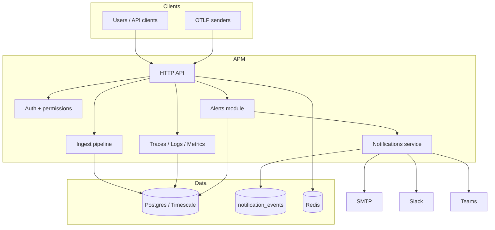
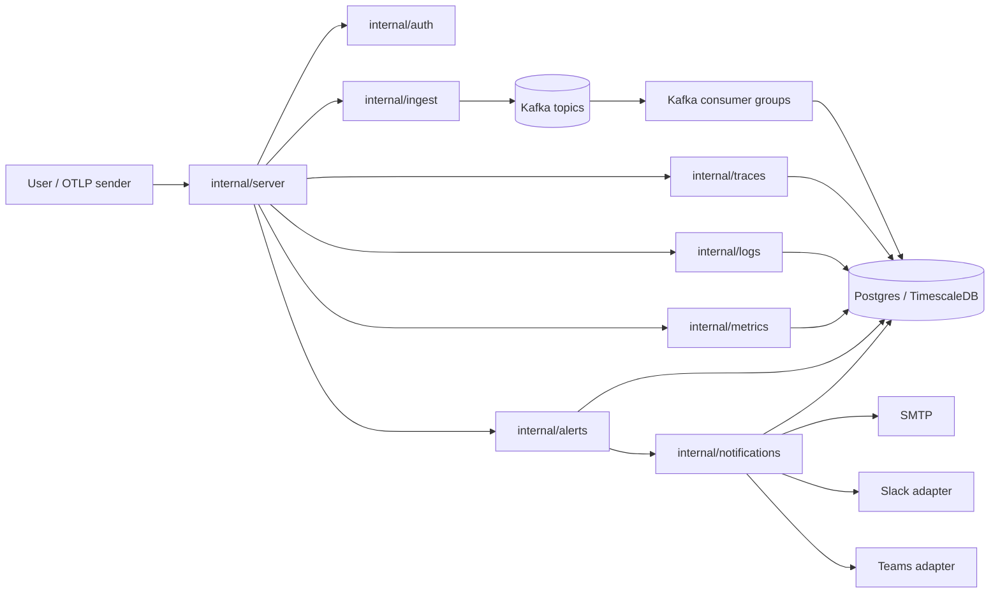
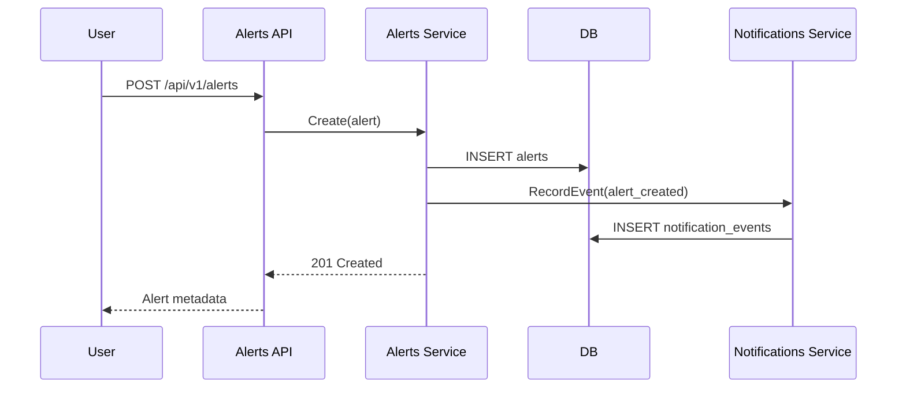
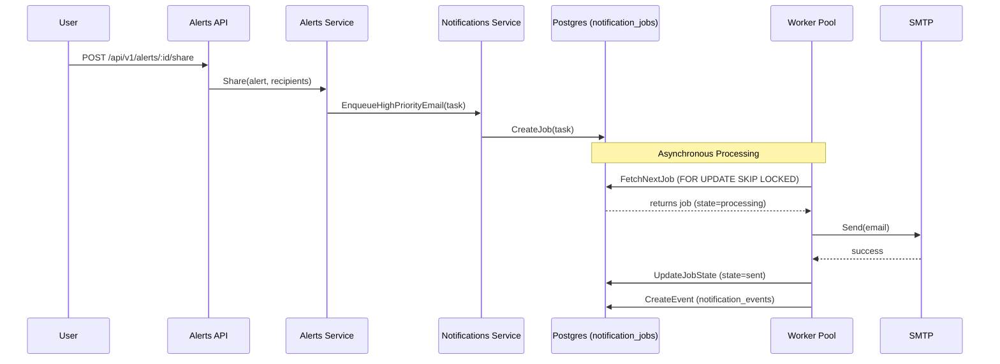
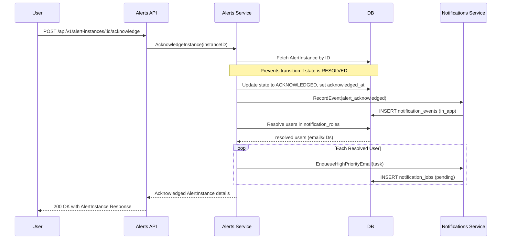
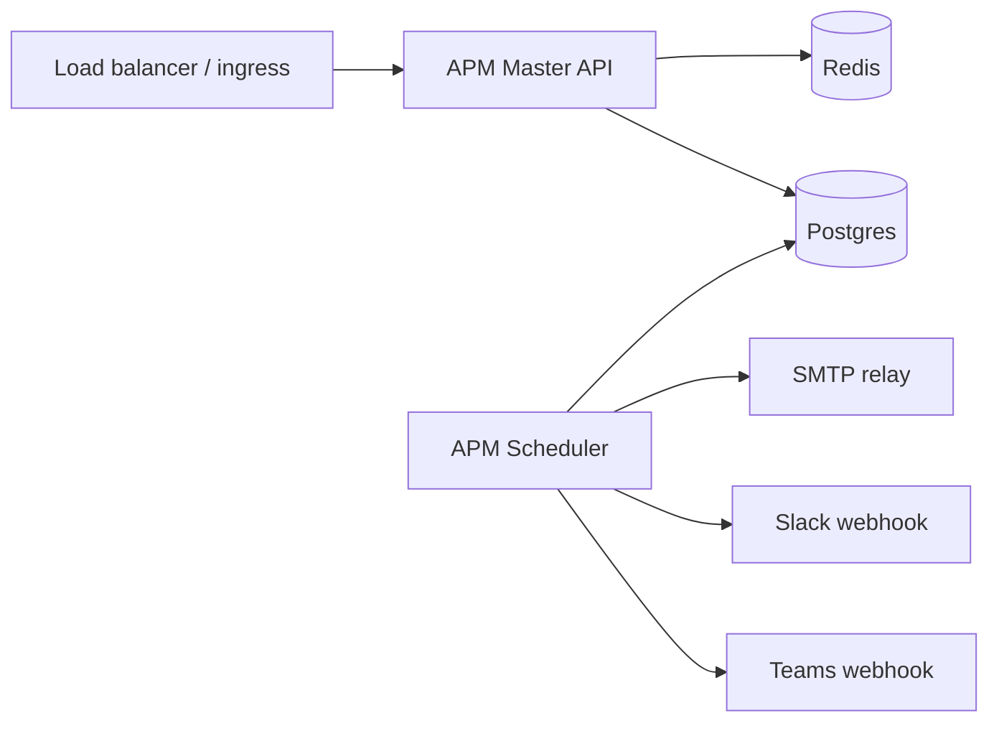

# Architecture Guide

## 1. High-Level Architecture

APM Master is a modular Go service for observability. Its core purpose is to collect telemetry signals (traces, logs, and metrics), store them in a shared data store, expose query APIs for investigation, and optionally generate alerting workflows on top of that telemetry data.

### System overview

The main APM architecture is built around four layers:

1. Ingest layer
   - accepts OTLP-style JSON data at /api/v1/ingest/traces, /logs, and /metrics
   - maps raw telemetry to internal models for spans, log records, and metric points
2. Storage layer
   - persists telemetry and alert state in Postgres/TimescaleDB
3. Query layer
   - serves traces, logs, and metrics through dedicated APIs for operators and dashboards
4. Alerting layer
   - turns important conditions into alert definitions and notification events

- API entry point: Gin server in internal/server that exposes auth, ingest, query, and alert endpoints
- Core application modules: internal/auth, internal/ingest, internal/traces, internal/logs, internal/metrics, internal/alerts, and internal/notifications
- Data layer: Postgres/TimescaleDB with migrations under migrations/ for telemetry, alerts, auth, and notification state
- Delivery and integrations: SMTP-based email notifications plus Slack/Teams provider hooks for future channel delivery

The main architectural idea is that the API layer coordinates user and service requests, the ingest layer writes telemetry into the database, the query modules read and summarize the stored data for operators, and the alert/notification modules add operational visibility on top of that data.



### Main APM architecture

The application is organized around a few primary responsibilities:

- internal/server: boots the HTTP API, registers routes, applies middleware, and exposes /health
- internal/auth: authenticates users, issues tokens, manages API keys, and enforces permission checks used by protected endpoints
- internal/ingest: accepts telemetry payloads from OTLP-style clients, normalizes them, publishes durable Kafka events, and persists them through Kafka consumer groups
- internal/traces: lists traces, fetches span details, and correlates service latency and failure data
- internal/logs: lists structured log records, filters them by severity and trace context, and supports trace-to-log correlation
- internal/metrics: lists metric names, reads time series, computes aggregations, and exposes histograms for dashboard and SLO-style analysis
- internal/alerts: stores alert definitions, validates severity and conditions, and shares alerts with recipients
- internal/notifications: records notification events and dispatches them through provider adapters
- internal/scheduler: registers and executes background jobs (alert evaluation, data retention)
- internal/retention: manages TTL configurations and sweeps old telemetry data from TimescaleDB



### Request and data flow across the main APM modules

1. **Authentication & Ingestion**:
   - A client or OpenTelemetry SDK sender hits the Gin HTTP server (`internal/server`).
   - The server validates the request using `APIKeyAuth` middleware (checks `X-API-Key` header) or JWT verification, injecting the `OrgID` context.
2. **Kafka Serialization & Production**:
   - Telemetry signals enter through `/api/v1/ingest/traces`, `/logs`, or `/metrics`.
   - The ingest service maps OTLP JSON data to internal Go struct models (Spans, Log Records, Metric Points).
   - Validated signals are serialized and published as JSON events to specific Kafka topics (`apm.telemetry.traces.v1`, `apm.telemetry.logs.v1`, `apm.telemetry.metrics.v1`). The producer uses LZ4 compression and configurable batch/timeout buffers to optimize network roundtrips.
3. **Kafka Batch Consumption & High-Performance TimescaleDB Write**:
   - Background consumer workers run in goroutine pools.
   - For each topic, consumer groups batch messages according to configuration limits.
   - To maximize ingestion write speed and reduce DB CPU load, persistence utilizes the **PostgreSQL binary COPY protocol** via `pgx.CopyFromRows`. 
   - If payload parsing fails or contains toxic data, messages are isolated to Dead-Letter Queue (DLQ) topics (e.g. `apm.telemetry.traces.dlq.v1`) to guarantee ingestion pipeline continuity.
4. **Querying & Analytical Pipelines**:
   - The `traces`, `logs`, and `metrics` modules query the TimescaleDB tables for dashboards, summaries, or deep-dives.
   - Spans are assembled into parent-child trees to represent distributed traces, and logs are correlated to specific spans using `trace_id` mappings.
5. **Alert Evaluation Loop**:
   - A background alerts scheduler evaluates rules on a configured cron/interval cadence.
   - The rules query metrics directly from TimescaleDB using correct mathematical aggregation operations (e.g., PostgreSQL `percentile_cont` for exact P95/P99 latency calculations, rather than averaging pre-calculated averages).
   - When a rule triggers, an `AlertInstance` is written to database with state = `FIRING`. Acknowledging or resolving the instance updates its state machine and registers audit trail timestamps (`triggered_at`, `acknowledged_at`, `resolved_at`).
6. **Durable Priority Queueing & Worker Execution**:
   - Alert state transitions and sharing requests insert jobs into the `notification_jobs` table.
   - The system separates alerts into high priority (e.g., priority `10`) to bypass lower-priority transactional jobs (priority `0`).
   - Concurrent worker pool threads poll the queue utilizing database-backed locks via:
     `UPDATE notification_jobs SET state = 'processing' WHERE id = (SELECT id FROM notification_jobs WHERE state = 'pending' AND run_at <= now() ORDER BY priority DESC, created_at ASC LIMIT 1 FOR UPDATE SKIP LOCKED) RETURNING ...`
     This prevents race conditions and ensures horizontal worker scalability.
   - Failed notifications undergo exponential backoff retries (`2^attempts` seconds) and are re-scheduled by modifying `run_at`. Hard failures exceeding `max_attempts` transition to the `dead_letter` state and audit trails are logged in the `notification_events` table.


This gives the application a clear separation of concerns: authentication, data ingestion, data query, alert management, and delivery.

### External dependencies

- Postgres / TimescaleDB for telemetry and event state
- Apache Kafka for durable, replayable telemetry ingestion
- Redis for API rate limiting
- SMTP provider for email delivery
- Slack and Teams adapters (currently placeholders in the notification package)
- JWT signing material supplied through environment variables

## 2. Low-Level Design

### Module breakdown

#### internal/server
- builds the Gin router
- wires middleware for request IDs, logging, recovery, API rate limiting (via Redis), and body limits
- exposes /health

#### internal/auth
- creates users, orgs, invites, roles, and API keys
- validates JWT access tokens for protected APIs

#### internal/ingest
- receives OTLP-style JSON documents
- writes traces, metrics, and logs into relational tables

#### internal/alerts
- manages alert definitions (rules) and alert instances (incidents)
- exposes HTTP endpoints to list, get details, and acknowledge alert instances, with query filtering and organization scoping
- records alert events, resolves notification roles, and schedules high-priority emails through the notification service

#### internal/notifications
- implements a database-backed durable queue using the `notification_jobs` table
- runs a concurrent worker pool utilizing `FOR UPDATE SKIP LOCKED` to safely coordinate delivery without lock contention
- handles exponential backoff retries and dead-letter queue transitions on persistent provider failures
- guarantees idempotent delivery using `reference_id` checks
- ensures graceful shutdown by allowing active jobs to finish execution before stopping

### Package structure

- cmd/apm: application entry point
- internal/config: environment-driven configuration
- internal/db: DB initialization and migration wiring
- internal/notifications: service, worker, store, providers, models
- internal/alerts: alert domain model and service handlers
- internal/scheduler: cron and interval-based background job execution engine
- internal/retention: tasks and logic for managing data lifecycle and deletion

### Core workflows

#### Alert creation flow



#### Alert sharing flow



#### Alert acknowledgement flow



### Alert Concepts & Lifecycle

#### Alert Definition vs Alert Instance
* **Alert Definition**: The monitoring rule. It specifies the configuration (metric query, condition threshold, duration window, evaluation interval, severity, and notification recipient roles).
* **Alert Instance**: Represents a real incident generated by the scheduler. A single Alert Definition can generate multiple alert instances over time as the condition triggers and recovers. Alert instances are persistent records in the `alert_instances` table that track the history of occurrences.

```
   Alert Definition (Monitoring Rule)
           │
           ▼ (Condition triggers)
     Alert Instance (Incident Created)
           │
           ├─► FIRING
           │     │
           │     ▼ (Operator acknowledges)
           ├─► ACKNOWLEDGED (suppresses repeat alerts, records audit)
           │     │
           │     ▼ (Condition recovers)
           └─► RESOLVED (ends incident lifecycle)
```

### Database interactions

The current persistence model uses Postgres tables created by migrations:

- alerts: stores alert definitions, metadata, and the associated `notification_roles`
- alert_instances: stores firing alert incidents and tracks their full lifecycle: state (`FIRING`, `ACKNOWLEDGED`, `RESOLVED`), transition timestamps (`triggered_at`, `acknowledged_at`, `resolved_at`), values, and thresholds.
- notification_jobs: stores pending, processing, retry, and dead-letter notification tasks with scheduling and retry counts
- notification_events: stores final delivery records, status, error details, and metadata

Key operational table fields include:

- state: pending / processing / sent / failed / dead_letter
- attempts: number of processed execution attempts
- max_attempts: limit of retries before moving to dead_letter state
- run_at: scheduling time for initial poll and retries

### Queue / event flow

The notification queue is a PostgreSQL-backed durable queue that operates as follows:

- **Enqueueing**: All email/notification tasks are inserted into the `notification_jobs` table in the `pending` state with `run_at = now()`.
  - **High Priority (`Priority = 10`)**: Critical system and monitoring alerts (firing, resolved, acknowledged transitions).
  - **Normal Priority (`Priority = 0`)**: Transactional notifications (forgot password, manual sharing, invitations).
- **Idempotence**: High-priority alert notifications utilize a check-before-insert pattern with a unique `reference_id` (e.g. alert definition and recipient mapping) to prevent redundant enqueuing.
- **Asynchronous Polling**: A pool of concurrent worker threads query the database for pending jobs where `run_at <= now()`. Ready jobs are fetched sorting by `priority DESC` first, and then `created_at ASC` (FIFO).
- **Concurrency Control**: Workers lock exactly one job concurrently using a PostgreSQL subquery with `FOR UPDATE SKIP LOCKED` (e.g., `ORDER BY priority DESC, created_at ASC LIMIT 1 FOR UPDATE SKIP LOCKED`). This avoids contention, guarantees priority order execution, and ensures each job is assigned to exactly one worker.

### Error handling and retry strategy

- **Exponential Backoff**: If a notification provider fails to deliver, the worker increments the job's `attempts` count, calculates a backoff delay (`2^attempts` seconds, capped at 5 minutes), and sets `run_at` to the future execution time, keeping the state as `pending`.
- **Dead-Letter State**: When a job fails and reaches its `max_attempts` count, it is transitioned to `dead_letter` state with the last delivery failure error written to `last_error`.
- **Graceful Shutdown**: Workers intercept context cancellation during server shutdown. They immediately stop fetching new tasks, but allow active delivery operations to finish and update their state in the database before the worker pool exits.

### Scaling strategy

- **Horizontal Scalability**: The database-backed queue enables multiple API server instances to safely run notification workers. Using `FOR UPDATE SKIP LOCKED` guarantees conflict-free job distribution across instances.
- **Worker Pool**: Each worker instance utilizes a configurable worker pool size to perform multiple concurrent provider delivery operations.

### Design decisions and tradeoffs

- **PostgreSQL Durable Queue**: Eliminates process-local in-memory queues, ensuring notifications survive server crashes. However, it introduces DB polling and locking overhead.
- **DB-backed event records**: Good for auditability and troubleshooting, but adds write amplification to every delivery attempt
- **Provider abstraction**: Clean extension point for future integrations, but current Slack/Teams providers are not yet fully implemented
- **Percentile and Average Aggregations**: Evaluating metric alert thresholds using Go-level average-of-averages/average-of-percentiles calculations is mathematically incorrect. We query the actual, exact aggregate metrics directly from the raw database tables via PostgreSQL `percentile_cont` and `AVG(value)`. This trades off the speed of pre-aggregated continuous aggregate views (which do not support mathematically correct percentiles without the TimescaleDB Toolkit extension) for exact correctness. Querying raw data is fast for typical short evaluation windows (5–15 minutes) but may incur performance overhead for extremely large windows due to sorting raw records.

## 3. Deployment Architecture

A typical deployment consists of:

1. one application instance running the API server and notification worker (can be split into API and Scheduler processes)
2. one Postgres/TimescaleDB instance for telemetry and notification state
3. one Redis instance for rate limiting
4. SMTP or another mail transport for email notifications



## 4. Operational Guidance

- use /health to confirm process availability
- inspect notification_events for delivery status and failure diagnostics
- use structured logs for notification-queue, SMTP, and auth failures
- add a durable queue and retry worker before relying on the notification path in production
