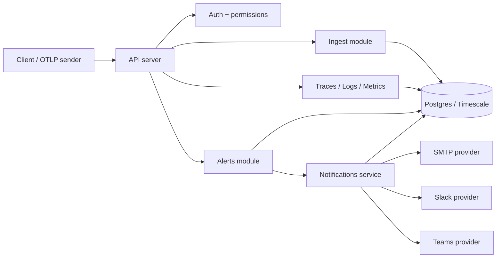

# APM Master

APM Master is a Go-based observability platform for traces, logs, metrics, and alerts. The product is not only an alerting tool; its primary value is to ingest telemetry from applications and provide a way to explore service behavior, latency, failures, and operational signals.

## What APM Master does

APM Master combines four core capabilities:

1. Telemetry ingestion
   - accepts OTLP-style JSON payloads for traces, logs, and metrics
   - normalizes them into internal models and writes them into Postgres
2. Trace analysis
   - stores spans, service names, durations, trace IDs, status codes, and parent/child relationships
   - exposes trace listing and trace detail endpoints for debugging request flow
3. Log and metrics exploration
   - stores structured logs with severity and trace correlation
   - stores metric samples, histograms, summaries, and aggregation views for dashboards and SLO-style analysis
4. Alerting and notification
   - stores alert definitions and routes notifications for alert sharing and operational events

The main APM story is therefore: ingest telemetry -> store it -> query it -> alert on important conditions.

## Core APM workflow

### 1. Ingest telemetry

The main ingestion routes are:

- POST /api/v1/ingest/traces
- POST /api/v1/ingest/logs
- POST /api/v1/ingest/metrics

These endpoints accept OTLP-style JSON payloads rather than protobuf. The ingest layer maps them into the internal trace/log/metric domain models and sends them through buffered pipelines to the database.

### 2. Query telemetry

Once data is stored, the API exposes:

- GET /api/v1/traces: list span summaries and trace-level views
- GET /api/v1/traces/:traceID: inspect all spans for one distributed trace
- GET /api/v1/logs: list logs with filters such as service, severity, trace ID, and time range
- GET /api/v1/metrics: list metric names and samples, plus series, aggregation, and histogram endpoints

These are the real APM primitives that give operators the ability to investigate latency, errors, service health, and usage trends.

### 3. Alert on operational conditions and manage incident lifecycle

Alerting is an important layer on top of the telemetry system. 

#### Alert Definition vs Alert Instance
* **Alert Definition**: Defines a monitoring rule (e.g., metric threshold condition, evaluation window, severity, name, and notification roles).
* **Alert Instance**: Represents a real, database-backed incident generated by the scheduler when an alert definition's condition is triggered. Multiple instances can exist historically for a single definition.

Alert definitions live under `/api/v1/alerts` and evaluate incoming telemetry on a fixed cadence. When a condition triggers, an **Alert Instance** is created.

Each alert instance progresses through the following lifecycle states:
- `FIRING`: The condition triggers, an alert instance is created, and email notifications are sent to the configured roles.
- `ACKNOWLEDGED`: An operator acknowledges the incident, recording an audit trail and suppressing duplicate notification jobs.
- `RESOLVED`: The condition recovers, saving the recovery time, ending the incident lifecycle, and sending a resolution notification.

The HTTP APIs expose the following endpoints for alert and incident management:
- `POST /api/v1/alerts`: Create an alert definition.
- `GET /api/v1/alerts`: List alert definitions.
- `GET /api/v1/alerts/:id`: Get alert definition details.
- `PUT /api/v1/alerts/:id`: Update an alert definition.
- `DELETE /api/v1/alerts/:id`: Delete an alert definition.
- `POST /api/v1/alerts/:id/share`: Share an alert definition via email.
- `GET /api/v1/alert-instances`: List all alert instances with filtering support:
  - `state` (`FIRING`, `ACKNOWLEDGED`, `RESOLVED`)
  - `severity`
  - `alert_id`
  - `from` / `to` (RFC3339 timestamp ranges)
  - `page` / `page_size`
- `GET /api/v1/alert-instances/:id`: Get detailed alert instance metrics, state, and its associated alert definition info.
- `POST /api/v1/alert-instances/:id/acknowledge`: Acknowledge a specific firing alert incident. Prevents transitions if already resolved.


### 4. Notification and delivery

The notification module implements a database-backed durable queue that supports **priority-based execution**:
* **High Priority (`Priority = 10`)**: Critical system and monitoring alerts (firing, resolved, acknowledged transitions).
* **Normal Priority (`Priority = 0`)**: User-initiated transactional messages (forgot password links, user invitations, manual sharing).

Workers poll the queue by ordering jobs by `priority DESC` then `created_at ASC`. This guarantees that critical health incidents leapfrog lower-priority transactional messages in the queue. The module records delivery state in the database and routes messages through provider adapters.

## APM architecture overview

### Major components

- API / routing layer: Gin-based HTTP server in [internal/server](file:///home/maitri/project/apm_master/internal/server)
- Authentication and access control: [internal/auth](file:///home/maitri/project/apm_master/internal/auth)
- Telemetry ingest and query modules: [internal/ingest](file:///home/maitri/project/apm_master/internal/ingest), [internal/traces](file:///home/maitri/project/apm_master/internal/traces), [internal/logs](file:///home/maitri/project/apm_master/internal/logs), [internal/metrics](file:///home/maitri/project/apm_master/internal/metrics)
- Alert management: [internal/alerts](file:///home/maitri/project/apm_master/internal/alerts)
- Notification delivery: [internal/notifications](file:///home/maitri/project/apm_master/internal/notifications)
- Database connection pool and migrations: [internal/db](file:///home/maitri/project/apm_master/internal/db) and migrations under [migrations/](file:///home/maitri/project/apm_master/migrations)
- Structured logging: [internal/logger](file:///home/maitri/project/apm_master/internal/logger)

### Request and data flow

1. An operator or service authenticates through the auth module.
2. Telemtry payloads are posted to the ingest endpoints and stored in Postgres.
3. The query modules read those tables for traces/logs/metrics.
4. Alert definitions are created through the alerts API.
5. Alert sharing and notification events are handed to the notification service for processing and audit recording.



### Detailed System Flow

1. **Ingest & Authentication**:
   - OpenTelemetry-instrumented client applications send telemetry payloads (traces, logs, or metrics) as JSON to the ingest endpoints (`/api/v1/ingest/...`).
   - The Gin router intercepts requests and validates them using APIKey validation (`X-API-Key` header) or JWT token authentication (`Authorization: Bearer <token>`). On success, the middleware injects the `OrgID` context.

2. **Decoupled Telemetry Pipeline (Ingest & Kafka)**:
   - The Ingest Handler translates incoming OTLP-style payloads into internal representations (Spans, Log Records, Metric Points).
   - Validated objects are serialized and published as JSON events to per-signal Apache Kafka topics (`apm.telemetry.traces.v1`, `apm.telemetry.logs.v1`, `apm.telemetry.metrics.v1`). The producer uses LZ4 compression and batching settings to achieve high throughput.

3. **High-Speed Database Persistence (Kafka Consumers & TimescaleDB)**:
   - Background Kafka consumer groups batch messages by signal type.
   - For writing to TimescaleDB, the system implements the **PostgreSQL binary COPY protocol** via `pgx.CopyFromRows` inside dedicated signal writers (`SpanWriter`, `LogWriter`, `MetricWriter`). This minimizes database lock contention and overhead compared to raw SQL `INSERT` statements.
   - If a batch payload is corrupt or repeatedly fails serialization, it is sent to a Dead-Letter Queue (DLQ) topic (e.g. `apm.telemetry.traces.dlq.v1`) to prevent ingestion pipeline blockages.

4. **Alert Evaluation Loop**:
   - A background scheduler evaluates active alerting rules (`AlertDefinition`) at regular intervals.
   - The scheduler queries TimescaleDB metric tables using exact aggregations (e.g., `AVG(value)` or `percentile_cont` for correct mathematical calculations over evaluation windows).
   - If a threshold is crossed, the scheduler creates or updates a persistent **Alert Instance** in the `alert_instances` table, shifting its state to `FIRING` and logging execution parameters.

5. **Durable Priority Queueing & Notification Dispatch**:
   - Status changes on alert instances (transitions to `FIRING`, `ACKNOWLEDGED`, `RESOLVED`) enqueue tasks to the database-backed `notification_jobs` table.
   - Jobs are assigned a priority (e.g., priority `10` for system incidents vs priority `0` for manual invites/sharing) to guarantee that critical health reports bypass lower-priority messages.
   - A pool of concurrent worker goroutines queries the `notification_jobs` table using:
     ```sql
     SELECT id FROM notification_jobs WHERE state = 'pending' AND run_at <= now() ORDER BY priority DESC, created_at ASC LIMIT 1 FOR UPDATE SKIP LOCKED
     ```
     This atomic update allows multiple horizontally scaled application processes to lock and process jobs concurrently without contention.
   - Workers attempt delivery via configured channels (SMTP, Slack hooks, Teams hooks).
   - **Retries & Backoff**: Failing delivery jobs are rescheduled with **exponential backoff** (`2^attempts` seconds) and updated to `pending`. If the job exceeds `max_attempts`, it is routed to the `dead_letter` state and delivery status is persisted in the `notification_events` table for auditable diagnostics.


## Major module responsibilities

The application is organized into the following main areas:

- [internal/server](file:///home/maitri/project/apm_master/internal/server): HTTP server and middlewares (API key validation, JWT auth, permissions, logging, recovery, request ID, body limits)
- [internal/auth](file:///home/maitri/project/apm_master/internal/auth): authentication, tokens, API keys, permissions
- [internal/ingest](file:///home/maitri/project/apm_master/internal/ingest): OTLP-style telemetry ingestion and asynchronous write pipelines
- [internal/traces](file:///home/maitri/project/apm_master/internal/traces): trace listing and span/trace lookup APIs
- [internal/logs](file:///home/maitri/project/apm_master/internal/logs): structured log listing and trace-to-log correlation
- [internal/metrics](file:///home/maitri/project/apm_master/internal/metrics): metric names, samples, aggregations, histograms, and time series
- [internal/alerts](file:///home/maitri/project/apm_master/internal/alerts): alert definitions, alert instances (incidents), background scheduling/evaluation, and sharing workflows
- [internal/notifications](file:///home/maitri/project/apm_master/internal/notifications): database-backed priority durable queue, concurrent retry workers with backoff/DLQ, provider adapters
- [internal/db](file:///home/maitri/project/apm_master/internal/db): database connection pool initialization and migration wiring
- [internal/logger](file:///home/maitri/project/apm_master/internal/logger): structured application logger initialization

### [internal/server](file:///home/maitri/project/apm_master/internal/server)
- starts the HTTP server
- exposes health checks at `/health`
- wires middleware such as API key validation, JWT authentication, permission checks, request logging, recovery, body limits, and request IDs

### [internal/auth](file:///home/maitri/project/apm_master/internal/auth)
- handles registration, login, invitations, token generation, and API keys
- provides organization scope and permission checks used by other modules

### [internal/ingest](file:///home/maitri/project/apm_master/internal/ingest)
- accepts OTLP-style JSON payloads for traces, metrics, and logs
- publishes validated telemetry into Kafka topics after mapping OTLP payloads into internal models
- runs Kafka consumer groups that batch records by signal and persist them to TimescaleDB/Postgres with COPY-based writers
- uses per-signal dead-letter topics for malformed or repeatedly failing telemetry messages

### [internal/traces](file:///home/maitri/project/apm_master/internal/traces) / [internal/logs](file:///home/maitri/project/apm_master/internal/logs) / [internal/metrics](file:///home/maitri/project/apm_master/internal/metrics)
- serve read and query APIs for telemetry data and derived summaries (like trace lists, log lists, metrics lists, and time series / aggregations)

### [internal/alerts](file:///home/maitri/project/apm_master/internal/alerts)
- manages alert definitions and alert instances (incidents)
- runs a background scheduler that evaluates alert rules against the Postgres database on a configurable interval
- provides query APIs with filtering, detail retrieval, and acknowledgement transitions for alert instances
- integrates with the notification service to record audit events and enqueue priority email notifications

### [internal/notifications](file:///home/maitri/project/apm_master/internal/notifications)
- implements a PostgreSQL durable queue using `notification_jobs`
- runs concurrent workers that process jobs using `FOR UPDATE SKIP LOCKED`
- handles exponential backoff retries and dead-letter queue (DLQ) state transitions
- stores audit records in `notification_events` for delivery status tracking

### [internal/db](file:///home/maitri/project/apm_master/internal/db)
- initializes the `pgxpool.Pool` database connection pool and handles connection pings
- manages automatic startup database migration execution using `golang-migrate`

### [internal/logger](file:///home/maitri/project/apm_master/internal/logger)
- initializes structured `slog` application logging with log level filtering and JSON formatting

## Local development setup

### 1. Start the dependencies

```bash
docker compose -f deploy/docker/docker-compose.yml --env-file deploy/docker/.env.docker up -d kafka postgres
```

The compose file loads configurations from `.env.docker` and starts Kafka on host port 9092 and a TimescaleDB instance on host port 5433 (mapped to container port 5432) with the configured database, user, and password used by the app.

### 2. Configure the runtime environment

Example:

```bash
export APP_ENV=development
export LOG_LEVEL=info
export HTTP_PORT=8080
export POSTGRES_HOST=localhost
export POSTGRES_PORT=5433
export POSTGRES_USER=apm_user
export POSTGRES_PASSWORD=apm_password
export POSTGRES_DB=apm_db
export JWT_SECRET="$(head -c 64 /dev/urandom | base64 | tr -d '\n=')"
```

### 3. Run the API server

```bash
go run ./cmd/apm
```

### 4. Smoke-test the main paths

Create an organization and API key:

```bash
curl -sS -X POST http://localhost:8080/api/v1/auth/register \
  -H 'Content-Type: application/json' \
  -d '{
    "org_name": "Demo Org",
    "org_slug": "demo-org",
    "first_name": "Demo",
    "last_name": "Owner",
    "email": "owner@example.com",
    "password": "StrongPass123!"
  }'

curl -sS -X POST http://localhost:8080/api/v1/auth/login \
  -H 'Content-Type: application/json' \
  -d '{
    "org_slug": "demo-org",
    "email": "owner@example.com",
    "password": "StrongPass123!"
  }'

curl -sS -X POST http://localhost:8080/api/v1/auth/api-keys \
  -H 'Content-Type: application/json' \
  -H 'Authorization: Bearer <ACCESS_TOKEN_FROM_LOGIN>' \
  -d '{"name": "demo-key"}'
```

The returned API key can be used to authenticate ingest and query requests.

## Deployment process

1. Provision a Postgres/Timescale database and ensure the migrations are applied.
2. Configure environment variables for the runtime, especially JWT_SECRET, POSTGRES_*, and SMTP_*.
3. Launch the application with the production build:

```bash
go build -o apm ./cmd/apm
./apm
```

4. Confirm the service is healthy:

```bash
curl http://localhost:8080/health
```

5. Monitor application logs and notification state to detect delivery failures.

## Configuration and environment variables

The configuration layer is defined in [internal/config/config.go](file:///home/maitri/project/apm_master/internal/config/config.go) and reads the following environment variables:

| Variable | Purpose | Default |
| --- | --- | --- |
| APPURL | base url for application links | http://localhost:3000 |
| APP_ENV | runtime environment name | development |
| LOG_LEVEL | logger verbosity | info |
| HTTP_PORT | API server port | 8080 |
| HTTP_READ_TIMEOUT_MS / HTTP_WRITE_TIMEOUT_MS / HTTP_IDLE_TIMEOUT_MS / HTTP_HEADER_TIMEOUT_MS | HTTP server timeouts | 10 s / 30 s / 120 s / 5 s |
| MAX_BODY_BYTES | maximum request body size | 10 MB |
| POSTGRES_HOST / POSTGRES_PORT / POSTGRES_USER / POSTGRES_PASSWORD / POSTGRES_DB | database settings | localhost / 5432 / apm_user / empty / apm_db |
| POSTGRES_TIMEOUT_MS | DB connection timeout | 5 s |
| JWT_SECRET | signing key for tokens and sessions | required |
| ACCESS_TOKEN_EXPIRY_MINS / REFRESH_TOKEN_EXPIRY_DAYS / INVITE_EXPIRY_DAYS / PASSWORD_RESET_EXPIRY_MINS | auth timeouts | 15 / 7 / 10 / 30 |
| EMAIL_FROM | sender identity for email notifications | no-reply@apm-master.local |
| SMTP_HOST / SMTP_PORT / SMTP_USERNAME / SMTP_PASSWORD | SMTP delivery settings | disabled unless set |
| KAFKA_BROKERS / KAFKA_CLIENT_ID / KAFKA_CONSUMER_GROUP | Kafka connection and consumer group settings | localhost:9092 / apm-master-ingest / apm-master-ingest-writers |
| KAFKA_TRACES_TOPIC / KAFKA_LOGS_TOPIC / KAFKA_METRICS_TOPIC | per-signal telemetry topics | apm.telemetry.*.v1 |
| KAFKA_TRACES_DLQ_TOPIC / KAFKA_LOGS_DLQ_TOPIC / KAFKA_METRICS_DLQ_TOPIC | per-signal dead-letter topics | apm.telemetry.*.dlq.v1 |
| KAFKA_TOPIC_PARTITIONS / KAFKA_TOPIC_REPLICATION_FACTOR / KAFKA_TOPIC_RETENTION_MS | topic provisioning defaults | 12 / 1 / 7 days |
| KAFKA_COMPRESSION / KAFKA_PRODUCER_BATCH_SIZE / KAFKA_PRODUCER_BATCH_BYTES / KAFKA_PRODUCER_BATCH_TIMEOUT_MS / KAFKA_PRODUCER_WRITE_TIMEOUT_MS | producer durability, compression, and batching | lz4 / 1000 / 1 MB / 10 ms / 10 s |
| KAFKA_CONSUMER_WORKERS / KAFKA_CONSUMER_BATCH_RECORDS / KAFKA_CONSUMER_BATCH_BYTES / KAFKA_CONSUMER_FLUSH_INTERVAL_MS / KAFKA_CONSUMER_MAX_ATTEMPTS | consumer group concurrency, batching, and retry policy | 3 / 1000 / 4 MB / 1 s / 5 |
| ALERT_EVALUATION_INTERVAL_MS | frequency of alert condition evaluation | 60 s (60000 ms) |

Important operational note: SMTP delivery is currently conditional on SMTP_HOST being set. If SMTP is not configured, the email provider will not send messages and the caller may only observe a silent no-op unless the worker logs indicate the misconfiguration.

## Monitoring and alerting

The current observability story is based on:

- HTTP health endpoint at /health
- structured application logs from internal/logger
- DB-backed notification event records in notification_events
- alert definitions in alerts

Recommended checks during operations:

1. watch the primary API logs for ingestion, auth, and notification errors
2. inspect the notification_events table for pending/failed statuses
3. confirm SMTP connectivity and credentials before enabling email notifications
4. validate that the notification worker is still running after deploys or restarts

## Go OpenTelemetry SDK smoke example

The ingest endpoints accept OTLP-style JSON payloads rather than protobuf. The Go demo under examples/otel_sdk_demo posts synthetic trace, metric, and log payloads and verifies the read APIs.

```bash
cd examples/otel_sdk_demo
export APM_BASE_URL=http://localhost:8080
# Optional: reuse a bootstrap token or API key if you already have one.
go run .
```

## Troubleshooting guide

### The API server does not start
- confirm the required environment variables are set
- ensure Postgres is reachable on the configured host/port
- verify that JWT_SECRET is at least 32 characters

### Ingest requests fail
- confirm a valid API key or bearer token is present
- ensure the database is online and migrations have been applied
- check the log output for validation or DB errors

### Alerts or notifications do not appear
- verify that the notification worker is running in the process
- confirm that SMTP_HOST/SMTP_PORT are configured when email delivery is expected
- inspect notification_events for pending/failed records and the related error field

### Health checks fail
- confirm that the process is listening on the configured HTTP_PORT
- verify that the /health endpoint responds after startup

## Verification checklist

Run these checks in a healthy environment:

1. `go test ./...`
2. `curl http://localhost:8080/health`
3. register and log in successfully
4. create an API key successfully
5. send synthetic trace/log/metric payloads with `go run ./examples/otel_sdk_demo`
6. confirm the query responses for /api/v1/traces, /api/v1/logs, and /api/v1/metrics
