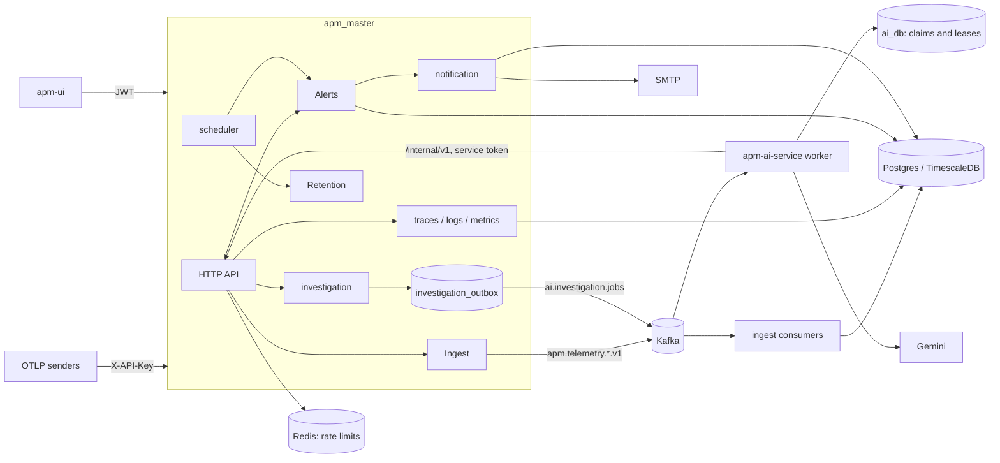
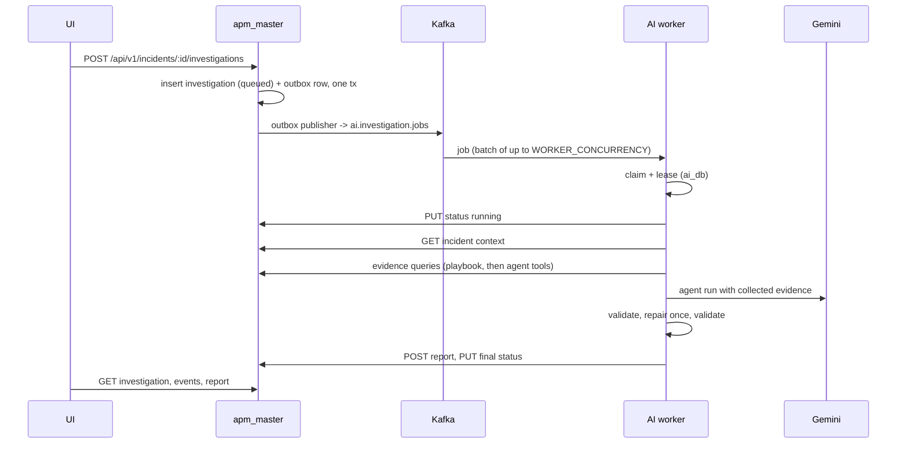
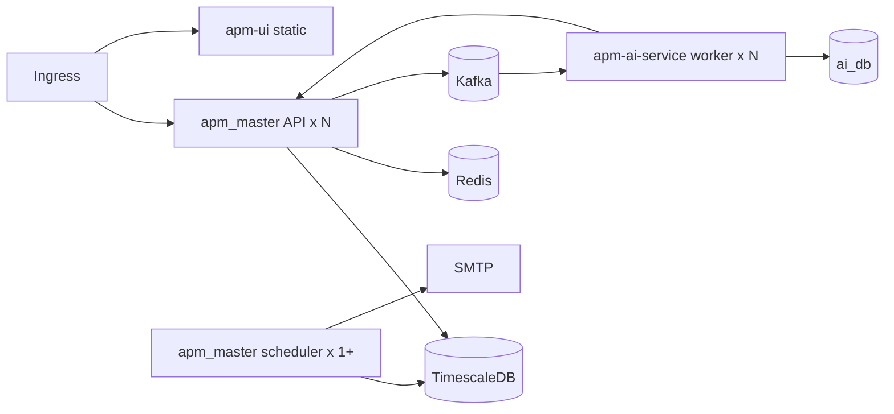

# Architecture

## System overview



Three services:

- **apm_master** (Go) owns every piece of product data: telemetry, alerts,
  incidents, notifications, users and investigations (status, timeline events,
  evidence and reports).
- **apm-ai-service** (Python) is a worker. It consumes investigation jobs from
  Kafka, gathers evidence through apm_master's internal API, asks the model
  for a report, validates it and writes it back. Its own database holds only
  job claims, leases and attempt history.
- **apm-ui** (React) is the dashboard. It calls only apm_master; the AI service
  exposes no product API.

External dependencies: Postgres with TimescaleDB, Kafka, Redis (rate limiting),
an SMTP relay, and the Gemini API.

## Data ownership

| Data | Owner | Written by | Read by |
|---|---|---|---|
| Spans, logs, metric points | apm_master | ingest consumers (COPY) | query APIs, alert evaluators, evidence executors |
| Alerts, alert instances (incidents) | apm_master | alert service, evaluation task | UI, investigation context |
| Notification jobs and events | apm_master | alert and auth services | notification worker |
| Investigations, events, evidence, reports | apm_master | public API (create, cancel, retry), internal API (AI worker) | UI |
| Investigation claims, leases, attempts | apm-ai-service | AI worker | AI worker |

There is one copy of each record. The AI service does not keep its own copy of
investigation events, evidence or reports; migration `0002` dropped those
tables. Every write it makes to apm_master must succeed, or the job fails and is
retried.

## Flows

### Telemetry ingest

1. An SDK posts OTLP JSON to `/api/v1/ingest/{traces,logs,metrics}` with an
   `X-API-Key`; the middleware resolves the org.
2. `ingest` maps the payload to internal wire types (`ingest/model`, versioned
   V1) and publishes synchronously to `apm.telemetry.<signal>.v1` (LZ4, batched).
   The request succeeds only after Kafka has accepted the batch.
3. Consumer groups batch records per signal and write them with the Postgres
   binary COPY protocol (`pgx.CopyFromRows`). Records that cannot be decoded
   go to `apm.telemetry.<signal>.dlq.v1`.

### Query

`traces`, `logs` and `metrics` each expose a `Reader` interface over the
hypertables. Spans are assembled into trees by `trace_id`/`parent_span_id`; logs
correlate to spans through `trace_id`. Metric series pick a bucket resolution
from the requested range. Points carry `{bucket, avg, min, max, count}`; the UI
formats the numbers.

### Alerting

1. When an alert is created, its condition string is parsed and stored as
   JSON in `alerts.condition_parsed`. An invalid condition is rejected with 400.
2. The scheduler runs the evaluation task on `ALERT_EVALUATION_INTERVAL_MS`
   under a Postgres advisory lock, so only one replica evaluates.
3. Each condition is routed to an evaluator by its source: metric, `logs…` or
   `spans…`. A breach creates an instance in `PENDING`, which becomes `FIRING`
   once the breach lasts the condition window. Operators acknowledge it, and it
   resolves when the condition recovers.
4. State changes enqueue high-priority notification jobs.

### Notifications

A durable priority queue in `notification_jobs`. Workers claim one job at a time
with `FOR UPDATE SKIP LOCKED`, ordered by `priority DESC, created_at ASC`. Alert
notifications use priority 10 and transactional mail (invites, password resets,
sharing) uses priority 0. Failed jobs back off by `2^attempts` seconds, capped at
5 minutes, and move to `dead_letter` after `max_attempts`. Each delivery attempt
is recorded in `notification_events`.

### AI investigation



1. Creating an investigation inserts the row and an outbox record in one
   transaction. The outbox publisher sends it to `ai.investigation.jobs`.
2. The worker claims the job in its own database. The claim takes a lease that
   a heartbeat renews and enforces a per-tenant concurrency limit. The worker
   then reports `running` to apm_master.
3. The orchestrator checks that the incident belongs to the job's tenant and
   classifies the incident. It then runs the matching **playbook**, a fixed
   first round of evidence queries. Then it lets the **agent** call the same
   tools through the same `EvidenceCollector`, which deduplicates queries,
   enforces the budget and timeout, truncates large outputs and records evidence
   IDs.
4. The report may cite only evidence collected in this investigation. A report
   that fails validation is repaired once, which strips uncited claims and
   downgrades the root cause. The investigation is `completed` only when the
   report is valid and its root cause is supported by evidence; otherwise it is
   `inconclusive`.
5. If the model is unavailable or no API key is configured, the worker writes
   a deterministic report from the playbook's findings instead.

## Package layout

### apm_master

```text
cmd/{apm,scheduler,migrate}   thin mains
internal/
  app/          the only place the dependency graph is built (RunAPI, RunScheduler)
  config/       typed env config (caarlos0/env), validation
  authz/        permission resources, actions, default catalogue
  server/       router bootstrap, health probes
  platform/     shared infrastructure; never imports a domain package
    apperr/ httpx/ middleware/ pg/ redisx/ kafkax/ logger/ ctxkeys/ retry/ module/
  auth/ ingest/ traces/ logs/ metrics/ alert/ investigation/ notification/ retention/ scheduler/
migrations/     golang-migrate SQL
```

Rules:

- Each domain module is one package with files named by role: `model.go`,
  `dto.go`, `store.go`, `service.go`, `handler*.go` and `module.go`.
- Handlers parse input with `platform/httpx` and render errors with
  `httpx.Handle`. Services return `platform/apperr` errors or module sentinel
  errors, which `apperr.Mapping` maps. They never return HTTP types.
- Consumers define the interfaces they need (`traces.Reader`, `alert.Notifier`).
- Tasks that must run on only one replica take `pg.WithAdvisoryLock`, which
  holds a single connection for lock, work and unlock.

### apm-ai-service

```text
app/
  main.py            FastAPI: /healthz, /readyz only
  worker/            main (signals), consumer (batches), routing (retry/DLQ headers), runner (one job)
  services/          orchestrator, evidence_collector, playbooks/, report_{validator,repair,synthesis}, classification
  agents/            pydantic-ai investigator; tools wrap EvidenceCollector
  tools/             one function per evidence query, budget, scope, truncation
  clients/           APMBackendClient (retries, envelope unwrap, error mapping), paths
  prompts/           templates/ + render.py
  schemas/           pydantic contracts: events, backend, report, tools, api
  domain/            enums, state machine, wire constants
  db/ repositories/  claim/lease tables (SQLAlchemy), Alembic in migrations/
  core/              sanitizer, guardrails, middleware
```

Rules:

- `schemas` and `domain` import nothing from other app packages.
- Only `clients` talks HTTP and only `repositories` talk SQL.
- Every tunable is a field of `config.Settings`; wire-level names live in
  `domain/constants.py`.
- A new incident category is a new `Playbook` subclass plus its entry in
  `PLAYBOOKS`.

### apm-ui

```text
src/
  app/          App, routes (lazy pages, auth guards), store, typed hooks, uiSlice
  api/          http.ts (axios + request()), baseApi.ts (RTK Query), one endpoint file per domain, types/ per domain
  mocks/        MSW handlers and data: dev with VITE_ENABLE_MOCKS=true, and Vitest
  features/     traces logs metrics alerts incidents investigations settings simulator auth
  components/   ui/ (primitives), charts/ (SVG), layout/
  constants/    api, routes, statuses (label/tone per status), time, storage
  hooks/        useTimeWindow (rolling query window), useToast
  styles/       tokens.css, global primitives
```

Rules:

- Server data lives in RTK Query; slices hold only UI state (session, theme, time range, filters).
- Pages and feature components style themselves with CSS Modules over the design tokens; inline styles only for computed values.
- Statuses render through the tables in `constants/statuses.ts`, never through literals in JSX.
- Mock data comes only from MSW, so app code has no mock branches and production builds contain no mocks.

## HTTP surface

apm_master serves everything under `/api/v1`. Responses use the envelope
described in [design.md](design.md#error-envelope).

| Area | Routes | Auth |
|---|---|---|
| Health | `GET /healthz`, `GET /readyz` | none |
| Auth | `/auth/register, login, logout, refresh-token, forgot-password, reset-password, invite, invite/accept`; `/auth/me, roles, permissions, api-keys` | public / JWT |
| Ingest | `POST /ingest/{traces,logs,metrics}` | API key |
| Traces | `GET /traces`, `GET /traces/:traceID` | JWT + `traces:read` |
| Logs | `GET /logs`, `GET /logs/trace/:traceID` | JWT + `logs:read` |
| Metrics | `GET /metrics`, `GET /metrics/:name/{values,series,aggregations,histogram}` | JWT + `metrics:read` |
| Alerts | CRUD `/alerts`, `POST /alerts/:id/share`, `POST /alerts/:id/acknowledge` | JWT + `alerts:*` |
| Incidents | `GET /alert-instances`, `GET /alert-instances/:id`, `POST /alert-instances/:id/acknowledge` | JWT |
| Investigations | `POST/GET /incidents/:incident_id/investigations`; `GET /investigations/:id`, `/events`, `/report`, `/evidence/:evidence_id`; `POST /investigations/:id/{cancel,retry}` | JWT |
| Internal (AI worker) | `GET /internal/v1/incidents/:id/context`, `POST /internal/v1/investigation-evidence/query`, `PUT …/investigations/:id/status`, `POST …/investigations/:id/{report,events}` | service token |

List endpoints take `page` and `limit`. The default limit is 50 and the maximum
is 1000. Time ranges use `from`/`to` in RFC3339; when omitted, the range is the
last hour.

## Deployment



- apm_master runs with `APP_MODE=api`, `scheduler` or `all`. You can run any
  number of API replicas. Schedulers are also safe to replicate, because
  advisory locks make alert evaluation and retention run on one replica at a
  time.
- Migrations run as a separate step (`cmd/migrate`, or the `apm-migrate`
  compose service). The API migrates on startup only when `AUTO_MIGRATE` is
  true, which is the default only in development.
- AI workers scale horizontally up to the number of partitions on the job
  topic. Each worker runs up to `WORKER_CONCURRENCY` jobs at once.
